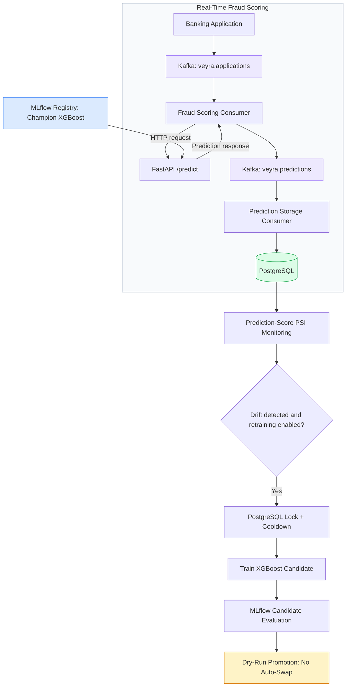

[](https://github.com/ananyagullapally/veyra/actions/workflows/tests.yml)
# Veyra — Real-Time Fraud Detection & MLOps Platform

Veyra is an end-to-end fraud detection platform combining machine learning, real-time event streaming, model serving, monitoring, and retraining orchestration.

## Technology Stack

- Python, XGBoost, scikit-learn
- MLflow for experiment tracking
- FastAPI for model serving
- Apache Kafka for event streaming
- PostgreSQL for prediction storage
- PSI for prediction drift monitoring
- pytest for automated testing

## Key Features

- Temporal train, validation, and test splitting
- Real-time fraud scoring
- Kafka-based prediction processing
- PostgreSQL prediction persistence
- Production drift monitoring
- Candidate model training and evaluation
- Champion-versus-candidate comparison
- Retraining cooldown and concurrency protection
- Dry-run model promotion

## Automated Retraining

Retraining is disabled by default. When enabled, the scheduled workflow checks production drift before initiating candidate training.

Model promotion remains dry-run only.

See [Automated Retraining Documentation](docs/automated_retraining.md).


## System Architecture



The scoring consumer publishes prediction events to Kafka. A separate storage consumer reads those events and persists them to PostgreSQL.

FastAPI exposes `/health` and `/predict`. The registered MLflow champion supplies the inference model.

Retraining is disabled by default, and dry-run promotion never automatically replaces the champion.

## Dataset & Model Evaluation

Veyra uses the Bank Account Fraud (BAF) dataset, containing 1 million privacy-preserving synthetic bank account applications. BAF provides application-specific banking, customer, and device signals, class imbalance, and temporal structure suitable for evaluating fraud detection.

The preprocessing pipeline handles missing-value sentinels, validates feature schemas, and removes constant features.

Data is split chronologically:

- Training: 794,989 applications
- Validation: 108,168 applications
- Testing: 96,843 applications

An XGBoost classifier produces fraud probabilities. MLflow tracks experiments and manages the registered champion model.

### Champion Model Performance

The registered XGBoost champion (version 1) was evaluated on the held-out test set using its existing decision threshold, without tuning on test data.

| Metric | Validation | Held-out Test |
|---|---:|---:|
| PR-AUC | 0.1835 | 0.2207 |
| ROC-AUC | 0.8935 | 0.8988 |
| Fraud recall | 80.00% | 79.27% |
| Precision | 5.94% | 6.98% |

**Registered decision threshold:** `0.013208`

**Threshold rationale:** The model uses a high-recall operating point aligned with an 80% validation-recall objective. This prioritizes identifying potentially fraudulent applications for further review rather than automatically rejecting them.

**False-positive tradeoff:** At the registered threshold, test precision is 6.98%, indicating that many flagged applications are legitimate. This configuration is intended for fraud screening, not autonomous rejection.

**Fixed-FPR analysis:** On the held-out test set, the maximum observed recall at a false-positive rate no greater than 1% was **27.59%** (observed FPR: 0.9998%). This is an evaluation operating point, not the registered deployment threshold.

**Evaluation scope:** Results are measured on the synthetic BAF dataset and should not be interpreted as verified performance on live banking traffic.

## API Latency Benchmark

Veyra's FastAPI `/predict` endpoint was benchmarked locally with the registered XGBoost champion model loaded in memory.

| Metric | Measured Latency |
|---|---:|
| Mean | 5.33 ms |
| p50 | 5.00 ms |
| p95 | 7.09 ms |
| p99 | 10.10 ms |
| Minimum | 4.28 ms |
| Maximum | 23.38 ms |

**Benchmark configuration:**
- Hardware: MacBook Pro, Apple M1 Pro, 16 GB RAM
- Operating system: macOS 26.6.2 (ARM64)
- API: FastAPI/Uvicorn on localhost
- Requests: 200 measured, following 20 warm-up requests
- Concurrency: 1 (sequential HTTP POST requests)
- Payload: One repeated, valid 33-feature application from the held-out BAF test split
- Timing: Client-side end-to-end HTTP response latency, excluding model startup

These measurements include HTTP request handling, feature validation, preprocessing, XGBoost inference, and response serialization.

**Limitations:** Results reflect a local, single-client benchmark with a repeated synthetic application. They do not establish production latency, concurrent load capacity, or Kafka consumer throughput.

## Kafka Scoring Throughput

An isolated local benchmark measured Veyra's sequential Kafka scoring workflow, including HTTP inference through FastAPI, prediction publishing, and synchronous offset commits.

| Metric | Result |
|---|---:|
| Successfully processed applications | 100 |
| Processing time | 1.538 seconds |
| Throughput | **65.02 events/second** |
| Consumer concurrency | 1 |
| Reported processing failures | 0 |

**Environment:** MacBook Pro (Apple M1 Pro, 16 GB RAM), local Apache Kafka 3.9.1, FastAPI, and XGBoost champion v1.

**Method:** A dedicated benchmark consumer group and separate input/output Kafka topics were used. The test processed 100 events containing a repeated synthetic BAF application payload. Timing began after input-event publication and ended after the final synchronous offset commit.

**Limitations:** This is a single-run, local benchmark, not a sustained-load or production throughput measurement. The result does not include initial event publication, PostgreSQL persistence, or concurrent consumer scaling.

## Local Development

### Prerequisites

- Python 3.11
- Docker and Docker Compose
- PostgreSQL
- Apache Kafka
- MLflow

### Environment Setup

Clone the repository:

```bash
git clone https://github.com/ananyagullapally/veyra.git
cd veyra
```

Create a Python environment and install the project:

```bash
conda create -n veyra python=3.11
conda activate veyra
pip install -e .
```

Configure environment variables using `.env.example` as a reference.

### Start Local Infrastructure

Start Kafka and PostgreSQL:

    docker compose up -d

Start MLflow from the project root in a separate terminal:

    mlflow server --backend-store-uri sqlite:///mlflow.db --artifacts-destination ./mlartifacts --host 127.0.0.1 --port 5001

MLflow UI: http://127.0.0.1:5001

Veyra defaults to MLflow at port 5001. To use another tracking server, set `MLFLOW_TRACKING_URI` before starting FastAPI or the scoring consumer, for example: `export MLFLOW_TRACKING_URI=http://127.0.0.1:5001`.

Kafka topics must be created explicitly because automatic topic creation is disabled.

Create the required topics after starting Docker Compose:

```bash
for topic in veyra.applications veyra.predictions veyra.applications.dlq; do
  docker exec veyra-kafka /opt/kafka/bin/kafka-topics.sh --bootstrap-server localhost:9092 --create --if-not-exists --topic "$topic" --partitions 1 --replication-factor 1
done
```

These settings are intended for local development with a single Kafka broker.

### Start Fraud Scoring Services

Start each service in a separate terminal after Kafka, PostgreSQL, and MLflow are running.

**FastAPI:**

    uvicorn veyra.serving.api:app --host 127.0.0.1 --port 8000

**Kafka scoring consumer:**

    python -m veyra.streaming.consumer

**Kafka prediction storage consumer:**

    python -u -m veyra.storage.consumer

**API health check:**

    curl http://127.0.0.1:8000/health

### Verified Test Results

Veyra has **145 passing automated tests**, verified in two separate runs:

| Test suite | Passed | Deselected |
|---|---:|---:|
| Non-integration tests (GitHub Actions CI) | 142 | 3 |
| PostgreSQL integration tests (local) | 3 | 142 |
| **Total passing tests** | **145** | — |

GitHub Actions runs the 142 non-integration tests automatically on pushes and pull requests.

The 3 PostgreSQL integration tests were verified separately against the local database:

```bash
VEYRA_RUN_DB_TESTS=1 python -m pytest tests/ -q -m integration

### Run the Retraining Scheduler

```bash
python -m veyra.orchestration.retraining_scheduler
```

Automated retraining is disabled by default.

To inspect the macOS scheduler configuration, see
[launchd Setup](deployment/launchd/README.md).

## Model Safety

Candidate models are evaluated against the registered MLflow champion.

Promotion decisions are dry-run only. Veyra does not automatically
replace the production champion.

## Portfolio Case Study

Read the [Veyra Portfolio Case Study](docs/portfolio_case_study.md) for the problem statement, dataset selection, technical architecture, engineering challenges, and verified outcomes.
